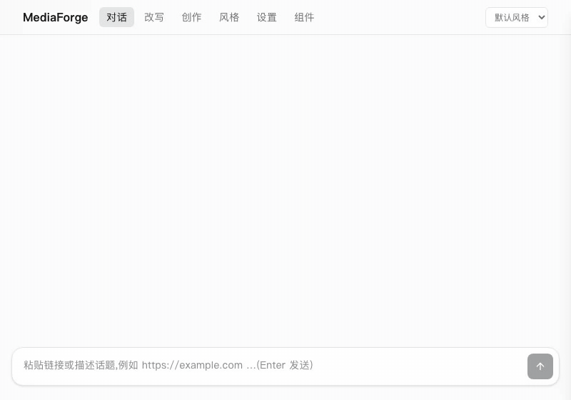
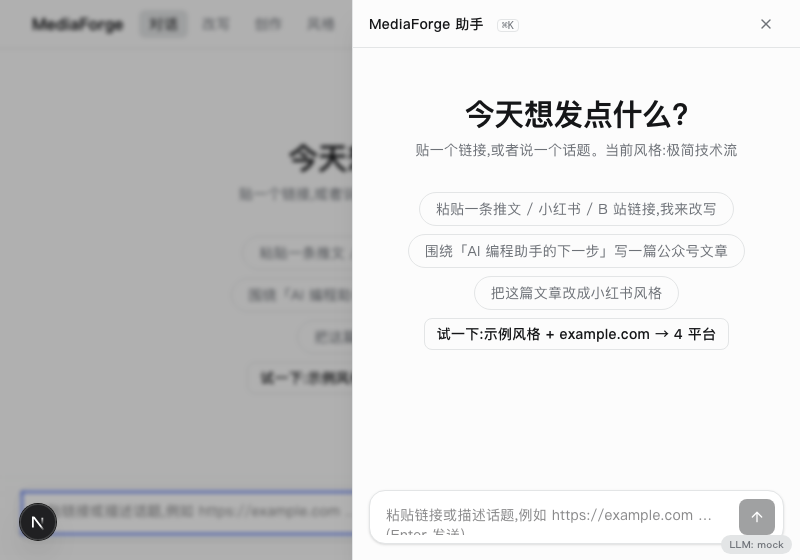
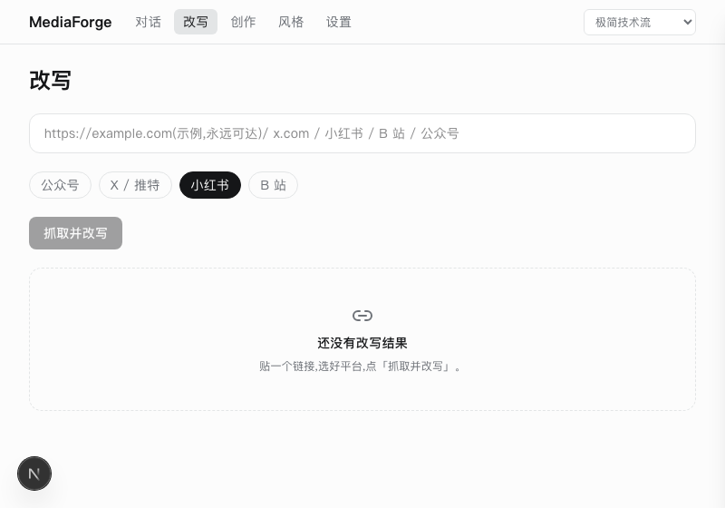
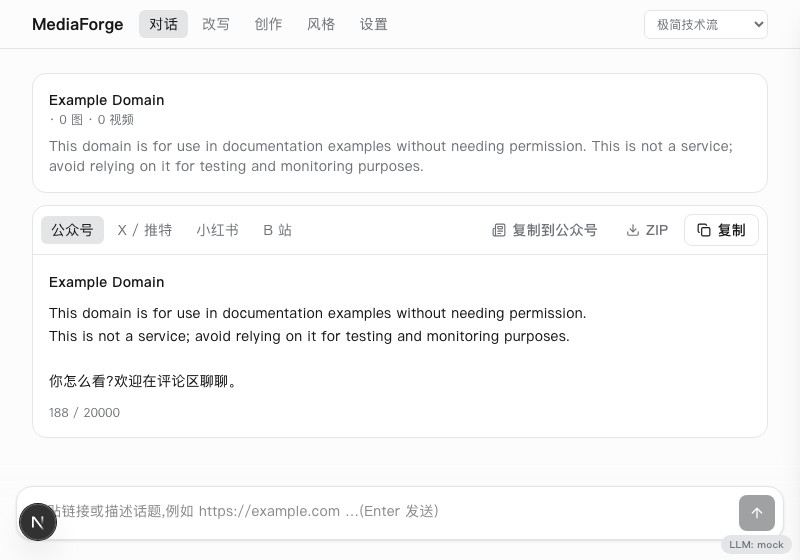
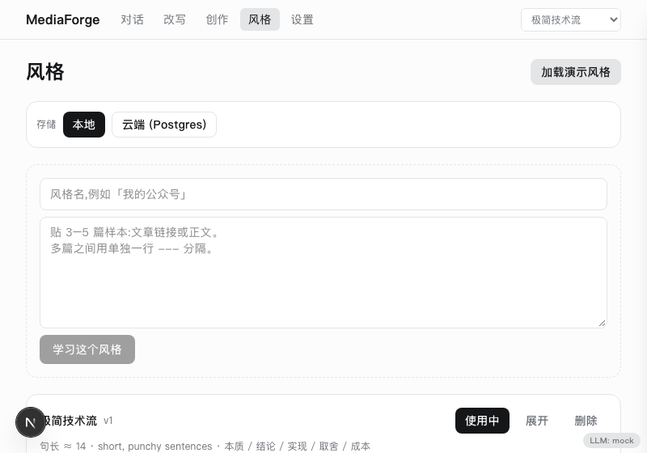

<div align="center">

# MediaForge

**贴一个链接,或说一个话题。AI 用*你的*文风,写给公众号、X、小红书、B 站。复制,发布。**

Paste a link or a topic. AI writes it in _your_ voice for WeChat, X, Xiaohongshu and Bilibili. Copy, publish.

[](.github/workflows/ci.yml)
[](.github/workflows/ci.yml)
[](.github/workflows/ci.yml)
[](LICENSE)

📣 [**v0.1.0 发布说明**](docs/release-notes.md) — 为什么做 MediaForge,以及它如何改变多平台内容工作流


</div>

## Quick Start

```bash
pnpm install                      # 1. 安装(Node 22 + pnpm 10)
cp .env.example .env.local        # 2. 复制环境变量(不填 key 也能跑:mock LLM)
pnpm dev                          # 3. http://localhost:3000
```

4. **第一行玩起来**:打开首页 → 点「试一下:示例风格 + example.com → 4 平台」,无需任何 key;或粘贴 `https://x.com/<user>/status/<id>` 让 Agent 抓取并改写。



## 5-minute tour

如果你是第一次接触 MediaForge,按下面顺序走一遍最快:

| Step | 做什么                                                                                                        | 在哪                         |
| ---- | ------------------------------------------------------------------------------------------------------------- | ---------------------------- |
| 1    | **看 dashboard**:6 个 quick action 卡 + 4 个 metric                                                           | `/`                          |
| 2    | **改写一条链接**:粘贴 `https://x.com/jack/status/20`,4 个平台草稿立刻出来                                     | `/rewrite`                   |
| 3    | **一键试一下 demo**:`/` 上「试一下」按钮自动加载示例风格并改写 example.com                                    | `/`                          |
| 4    | **学习你的风格**:贴几篇你写过的文章 → 提取句长 + 节奏 + 标志词                                                | `/styles` → 「加载演示风格」 |
| 5    | **测评文本**:把你准备发的草稿放进去,看 5 个信号分(句长/词汇/节奏/句数/禁忌)                                   | `/styles` → 卡片「测评」     |
| 6    | **创作**:话题 + 参考链接 → 流式长文 → 平台适配稿                                                              | `/editor`                    |
| 7    | **语义搜索**:`/search` 看 cosine 排序(演示用 mock embeddings)                                                 | `/search`                    |
| 8    | **MCP**:`pnpm demo:mcp` 起 MCP server;在 Claude Code/Cursor/Codex 里挂载后调用 `rewrite_url`/`learn_style` 等 | `docs/mcp-guide.md`          |
| 9    | **API 文档**:`/docs` 用 Stoplight Elements 渲染 OpenAPI 3.1 spec;`/api/openapi.json` 是 raw JSON              | `/docs`                      |
| 10   | **云端同步**(可选):`DATABASE_URL=...` → 「风格」页出现云端 tab + 版本历史 + 回滚                              | `/styles`                    |

每个步骤都不依赖任何 key,即可走通完整 demo 流程。

## Features

|                | 特性                                                                                                                                                                                                 |
| -------------- | ---------------------------------------------------------------------------------------------------------------------------------------------------------------------------------------------------- |
| **对话优先**   | 抓取、改写、学风格都是 agent 的 _tool_,UI 只渲染工具结果。<br/>                                                                      |
| **改写模式**   | 链接(X / 小红书 / B 站 / 公众号 / 任意文章)→ 抓取 → 选平台 → 一键复制,图片视频原样保留。<br/>                                         |
| **创作模式**   | 话题 + 参考链接 → 流式长文 → 适配多平台。<br/>                                                                                     |
| **风格 Agent** | 3–5 篇样本 → 语音特征 → 风格 Prompt;可用反馈或*你的手改*迭代,支持版本回滚与云同步。<br/>                                                |
| **导出与 MCP** | 公众号内联 HTML、ZIP 打包;MediaForge 本身也是 MCP server,可被 Claude Code / Cursor / Codex 调用([docs/mcp.md](docs/mcp.md))。<br/> |

无 `ANTHROPIC_API_KEY` 时所有路由返回确定性 mock(响应里 `"llm": "mock"`,右下角有徽章),方便试用与测试。

## Showcase

`pnpm dev` 后访问 [`/showcase`](http://localhost:3000/showcase),逐个预览 Button、PostTabs、PlatformPicker、Chat、LlmModeBadge、EmptyState。

## Architecture

```
┌──────────────┐   HTTPS    ┌──────────────────────────┐        ┌───────────────────────┐
│   Browser    │ ─────────▶ │  Vercel (Next.js 15)     │ ─────▶ │ Anthropic API (LLM)   │
│ React 19 UI  │ ◀───────── │  App Router + Route      │ ─────▶ │ Source sites / fxtwit │
│ localStorage │  stream    │  Handlers (Node runtime) │ ─────▶ │ Firecrawl (optional)  │
└──────────────┘            └────────────┬─────────────┘        └───────────────────────┘
                                         │ DATABASE_URL (optional)
                                         ▼
                            ┌──────────────────────────┐
                            │ Neon Postgres + Drizzle  │  风格云同步 / 版本
                            └──────────────────────────┘
```

详见 [docs/architecture.md](docs/architecture.md)。

## Tech Stack

| 层        | 选型                                                                                           |
| --------- | ---------------------------------------------------------------------------------------------- |
| 框架      | Next.js 15 App Router · React 19 · TypeScript (strict)                                         |
| UI        | Tailwind v4 (OKLCH tokens) · shadcn 约定(`cva` + `cn`) · Motion · lucide                       |
| AI        | Vercel AI SDK v5(`useChat` / `streamText` / tool-use)· Claude Sonnet 4.5 默认;不引入 LangGraph |
| 抓取      | `@mozilla/readability` + `linkedom`;X 走 fxtwitter;B 站走 view API;Firecrawl 兜底              |
| 数据      | Neon Postgres + Drizzle(可选;默认 localStorage)                                                |
| 集成      | `@modelcontextprotocol/sdk`(stdio MCP server)· `jszip`                                         |
| 测试 / CI | Vitest · GitHub Actions                                                                        |

## Configuration

| 变量                | 必需          | 说明                         |
| ------------------- | ------------- | ---------------------------- |
| `ANTHROPIC_API_KEY` | 否(缺省 mock) | 真实 LLM                     |
| `ANTHROPIC_MODEL`   | 否            | 默认 `claude-sonnet-4-5`     |
| `FIRECRAWL_API_KEY` | 否            | 登录墙页面兜底抓取           |
| `DATABASE_URL`      | 否            | Neon Postgres,启用风格云同步 |
| `JINA_API_KEY`      | 否            | **预留**,当前代码尚未读取    |

## Deployment

### Vercel + Neon,约 5 分钟

1. 把仓库导入 Vercel — 框架会自动识别 Next.js(`vercel.json` 已写好缓存与 cron 字段)
2. 可选:在 [Neon](https://neon.tech) 新建项目,拷连接串(带 `?sslmode=require`)。本地一次 `DATABASE_URL="…" pnpm db:push` 推 schema
3. Vercel → Project Settings → Environment Variables,贴这些(全部可选):
   - `ANTHROPIC_API_KEY` — 留空走 mock LLM;设了就用 Claude
   - `OPENAI_API_KEY` — 设了 `/api/embed` 切到真 text-embedding-3-small
   - `FIRECRAWL_API_KEY` — 设了 `/api/rewrite` 抓登录墙内容
   - `DATABASE_URL` — 设了云端风格同步/复制/重命名/版本历史可用
4. Deploy。打开 `/api/health` → `"mode":"anthropic"`(设了 key) 或 `"mode":"mock"`(没设)
5. 上传 GitHub Social Preview:Settings → Social preview → 拖 `docs/assets/social-preview.png`(1280×640)

完整说明(手动检查清单、Neon 步骤、Docker Compose):[docs/deployment.md](docs/deployment.md)。

### Docker 自托管

```bash
docker compose up -d --build                 # 仅应用,http://localhost:3000
docker compose --profile db up -d --build    # 附带 Postgres(DATABASE_URL=postgres://mf:mf@db:5432/mediaforge)
```

环境变量同上表,留空 `ANTHROPIC_API_KEY` 即 mock LLM。

### First push

本机首次推送到 GitHub:

```bash
git remote add origin git@github.com:frankfika/MediaForge.git   # 仅需一次
pnpm push            # 检查 .env/secrets 泄漏 + remote/tag 存在,然后 push main 和 v0.1.0 tag
pnpm push -- --check # 只跑检查,不推送(dry run)
```

推送后 Actions → Release workflow 会基于 tag 发 GitHub Release(CHANGELOG 需先有对应 `## [x.y.z]` 段)。

## Project Status

**v0.1.0** — 5 页面 · 13 个 API · MCP server · mock LLM · 演示数据 · 15 个单测。

Roadmap:

- [ ] 真实 key 下的端到端验证与 prompt 调优
- [ ] 登录态抓取成功率(只能尽力而为)
- [ ] Jina Reader 抓取后端
- [ ] 平台发布自动化
- [ ] e2e 测试、Storybook

文档:[architecture](docs/architecture.md) · [product-spec](docs/product-spec.md) · [style-agent](docs/style-agent.md) · [api](docs/api.md) · [data-model](docs/data-model.md) · [mcp](docs/mcp.md) · [ui-style-guide](docs/ui-style-guide.md)

## Contributing

欢迎 PR。`pnpm typecheck && pnpm test && pnpm build` 通过即可;详见 [CONTRIBUTING](.github/CONTRIBUTING.md)。

## License

[MIT](LICENSE)

## Acknowledgments

- [Firecrawl](https://github.com/mendableai/firecrawl) — 登录墙页面兜底抓取(可选集成)
- [Jina Reader](https://github.com/jina-ai/reader) · [Unstructured](https://github.com/Unstructured-IO/unstructured) — 调研参考(见 [research/](research/MEDIAFORGE_OPEN_SOURCE_LANDSCAPE.md)),尚未作为依赖接入
- [JSZip](https://github.com/Stuk/jszip) — 浏览器端 ZIP 打包
- [Model Context Protocol SDK](https://github.com/modelcontextprotocol/typescript-sdk) — MCP server
- [Mozilla Readability](https://github.com/mozilla/readability) · [linkedom](https://github.com/WebReflection/linkedom) · [Vercel AI SDK](https://github.com/vercel/ai) · [Vercel AI Chatbot](https://github.com/vercel/ai-chatbot)(产品形态参考)
